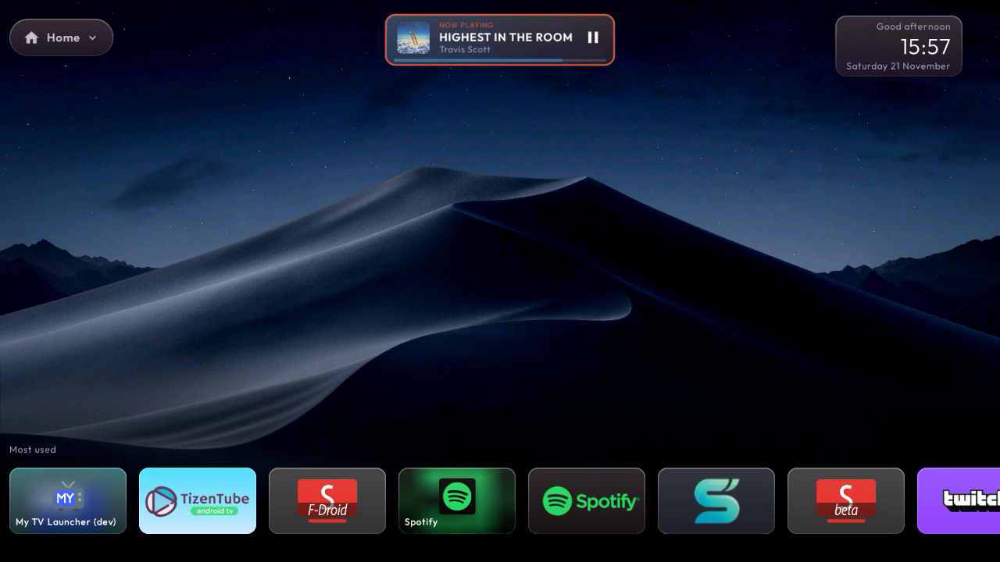
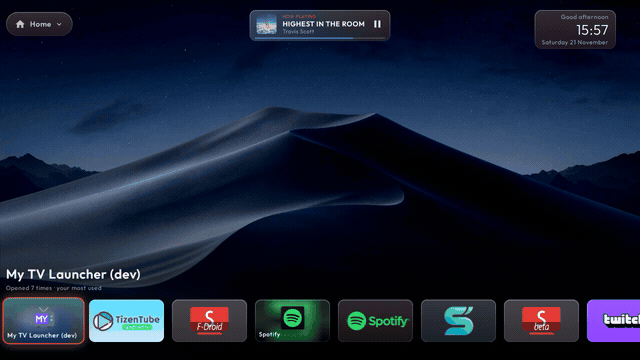
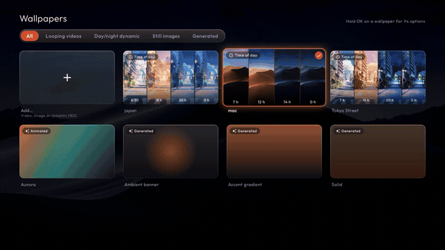

<div align="center">


# My TV Launcher

**A clean, fast, and modern home screen for Android TV.**  
No ads. No tracking. No clutter. Just your apps and your wallpapers.

[](https://github.com/alexcmb/MyTVLauncher/releases/latest)
[](https://developer.android.com/)
[](LICENSE.md)
[](#highlights)

<br>



<br><br>

[**Download APK (v0.15.2)**](https://github.com/alexcmb/MyTVLauncher/releases/latest) • [**Highlights**](#highlights) • [**Installation**](#installation)

</div>

---

## Highlights

Most TV launchers are cluttered with ads, recommendations, and sponsored content. My TV Launcher keeps things simple and gives you control over your screen.

- **Clean layout:** Your wallpaper takes center stage, with apps, favorites, and playback controls neatly arranged at the bottom.
- **Dynamic wallpapers:** Choose from looping videos, day/night wallpapers, aurora effects, or your own photos.
- **Modern design:** Smooth animations, glass effects, and accent colors that adapt to the focused app.
- **Side rail:** Organize apps into categories, switch TV inputs (HDMI/AV), and access settings.
- **Widgets & Gallery:** Manage up to 3 widgets in a full-screen visual gallery. Enjoy predesigned TV widgets (Weather & forecast, Storage & network monitor, Sun ephemeris & clock) or sideloaded app widgets. Press Up to show them and Down to hide them.
- **Screensaver:** A floating clock and Now Playing artwork appear when your TV is idle.
- **Privacy:** No accounts, no tracking, no telemetry, and no data collection. Works entirely offline.

<br>

<div align="center">
  
  <br><br>
  
</div>

---

## Installation

1. Download **`MyTvLauncher-v0.15.2.apk`** from [**Releases**](https://github.com/alexcmb/MyTVLauncher/releases/latest).
2. Install it on your Android TV (using a USB drive, an app like *Send Files to TV*, or ADB):
   ```bash
   adb install -r MyTvLauncher-v0.15.2.apk
   ```
3. Press **Home** on your remote and select **My TV Launcher** as your default launcher.

*(Requires Android 7.0 or newer. Dynamic day/night HEIC wallpapers require Android 9+)*

---

<details>
<summary><b>One-time setup for Android TV (Widgets & Now Playing)</b></summary>

<br>

Android TV builds do not include the standard system screens to grant widget hosting or notification access. You can grant both once over ADB:

**1. Enable widgets:**
```bash
adb shell appwidget grantbind --package alexcmb.mytvlauncher
```

**2. Enable Now Playing card:**
```bash
adb shell cmd notification allow_listener alexcmb.mytvlauncher/.media.NowPlayingListenerService
```

Once granted, widgets and the Now Playing card work automatically without any further setup.
</details>

<details>
<summary><b>For developers: building from source</b></summary>

<br>

Built with **Jetpack Compose for TV**, **Kotlin 2.4**, and **Android Gradle Plugin 9** (JDK 17+ required).

```bash
# Run unit tests
./gradlew testDebugUnitTest

# Build debug APK (installs side-by-side as alexcmb.mytvlauncher.dev)
./gradlew assembleDebug
```

Every PR is audited automatically via GitHub Actions (Tests, Android Lint, Semgrep, Gitleaks, OSV-Scanner, and CodeQL).
</details>

---

## Languages

Available in English and French.

## License

Free and open source under the [GPL-3.0 License](LICENSE.md).
